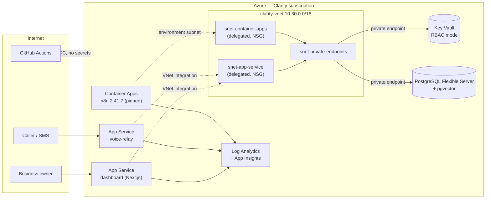

# Clarity Platform Foundation

**The Azure platform under ClarityOS, a multi-agent AI receptionist I built and run for small businesses at Clarity Process Group.**

Terraform · GitHub Actions (OIDC) · App Service · Container Apps · PostgreSQL Flexible Server · Key Vault · Private Endpoints · Azure Monitor

---

## What this is

ClarityOS answers calls and texts for small businesses: a voice agent, an SMS agent and a knowledge-base agent that answers from documents each customer uploads. This repo documents the platform those agents run on: how it's provisioned, how it's deployed, how traffic and secrets are kept private, and how I know it's healthy.

It's a production system, not a lab. Everything here is applied by CI from the private `clarity-platform` repo; the Terraform in this repo is copied from it with identifiers removed.

The security work on the AI layer itself (Prompt Shields, Sentinel, agent least privilege, the AI gateway) is in **[securing-clarityos](https://github.com/michaeledwards0/securing-clarityos)**. The Microsoft 365 side is in **[Copilot-readiness](https://github.com/michaeledwards0/Copilot-readiness)**.

## Architecture



## Three phases

| Phase | What I built | Doc |
|---|---|---|
| **1. IaC and delivery** | Terraform modules (one per concern) across four resource groups, remote state, one GitHub Actions pipeline using OIDC federation with plan → gated apply → app deploys in order, budget alerts | [phase-1](docs/phase-1-iac-and-delivery.md) |
| **2. Private network** | Flat VNet with delegated subnets for App Service and Container Apps, NSGs, private endpoints and private DNS for Key Vault and Postgres | [phase-2](docs/phase-2-private-network.md) |
| **3. Identity, secrets and observability** | A managed identity per workload, Key Vault in RBAC mode, a least-privilege Postgres role that makes row-level security real, diagnostic settings to Log Analytics, availability tests and alerts | [phase-3](docs/phase-3-identity-secrets-observability.md) |

## Decisions worth asking me about

- **Why a flat VNet, not hub-and-spoke.** Clarity is one application. A hub exists so many apps can share Bastion, DNS and firewalls; here it would be cost and coupling with no shared service to justify it.
- **Why App Service and Container Apps, not AKS.** Two web apps and one container that scales to zero. A Kubernetes control plane would be the most expensive and most-maintained thing in the estate.
- **Why the CI identity is scoped to four resource groups.** It never gets subscription Contributor. The one subscription-scoped grant it needs (Security Admin, for Defender plans) is applied by a human in a separate bootstrap root.
- **Why Key Vault's network ACL is still `Allow`.** GitHub-hosted runners come from rotating IP ranges, so an IP allowlist can't stay valid. RBAC is the gate today; a self-hosted runner inside the VNet is the fix (see "What's next").

## Repo layout

```
docs/                  phase write-ups
terraform/             modules copied from the production repo (identifiers removed)
pipeline/deploy.yml    the production GitHub Actions workflow
screenshots/           evidence, one folder per phase
```

## What's next

- Self-hosted GitHub runner inside the VNet, then Key Vault and Postgres public access off
- Key Vault purge protection on
- Operator's standing Key Vault Secrets Officer → PIM-eligible (`azurerm_pim_eligible_role_assignment`)

---

Michael Edwards · Founder & Cloud/AI Security Engineer, Clarity Process Group · [LinkedIn](https://linkedin.com/in/michael-edwards-cloud)
